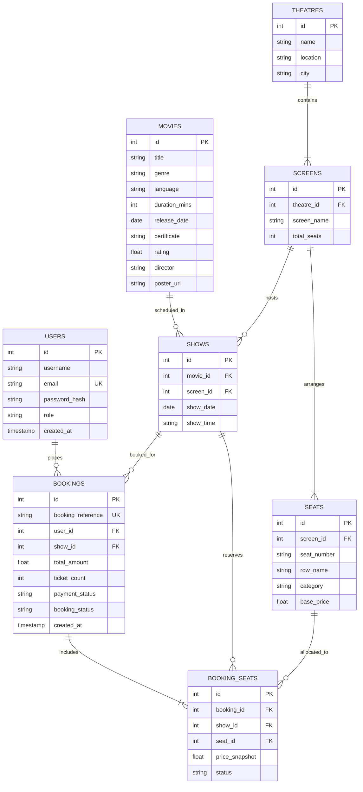

# CineBook — Database Systems Design Specification

## 1. System Overview
**CineBook** is a relational database management system designed for multiplex cinema ticketing and seat reservation. The database architecture guarantees:
- **Referential Integrity:** Primary and Foreign key constraints across 8 normalized entities.
- **Concurrency & Atomicity:** ACID transaction protection preventing duplicate ticket bookings for the same active seat.
- **Auditability:** Complete snapshot pricing and historical booking status tracking.

---

## 2. Entity-Relationship (ER) Architecture

---

## 3. Relational Schema & Table Definitions

### 1. `USERS`
Stores registered customer accounts and system administrators.
- `id` (NUMBER / INTEGER, PK, Auto-Generated)
- `username` (VARCHAR2(50), NOT NULL)
- `email` (VARCHAR2(100), UNIQUE, NOT NULL)
- `password_hash` (VARCHAR2(255), NOT NULL, SHA-256)
- `role` (VARCHAR2(20), CHECK IN ('user', 'admin'))
- `created_at` (TIMESTAMP, DEFAULT CURRENT_TIMESTAMP)

### 2. `MOVIES`
Catalog of featured and upcoming movies.
- `id` (NUMBER / INTEGER, PK)
- `title` (VARCHAR2(150), NOT NULL)
- `description` (VARCHAR2(2000))
- `genre` (VARCHAR2(100), NOT NULL)
- `language` (VARCHAR2(50), NOT NULL)
- `duration_mins` (NUMBER(4), CHECK > 0)
- `release_date` (DATE, NOT NULL)
- `certificate` (VARCHAR2(10), e.g., 'U', 'UA', 'A')
- `rating` (NUMBER(3,1), CHECK BETWEEN 0.0 AND 10.0)
- `cast_details` (VARCHAR2(1000))
- `director` (VARCHAR2(100))
- `poster_url` (VARCHAR2(500))
- `banner_url` (VARCHAR2(500))
- `is_upcoming` (NUMBER(1), CHECK IN (0, 1))

### 3. `THEATRES`
Physical multiplex cinema complexes across cities.
- `id` (NUMBER / INTEGER, PK)
- `name` (VARCHAR2(150), NOT NULL)
- `location` (VARCHAR2(255), NOT NULL)
- `city` (VARCHAR2(100), NOT NULL)

### 4. `SCREENS`
Auditoriums located within specific theatres.
- `id` (NUMBER / INTEGER, PK)
- `theatre_id` (FK -> `THEATRES(id)` ON DELETE CASCADE)
- `screen_name` (VARCHAR2(100), NOT NULL)
- `total_seats` (NUMBER(4), CHECK > 0)

### 5. `SEATS`
Individual physical seats within a screen.
- `id` (NUMBER / INTEGER, PK)
- `screen_id` (FK -> `SCREENS(id)` ON DELETE CASCADE)
- `seat_number` (VARCHAR2(10), NOT NULL)
- `row_name` (VARCHAR2(5), NOT NULL)
- `category` (VARCHAR2(20), CHECK IN ('Regular', 'Premium'))
- `base_price` (NUMBER(8,2), CHECK > 0)
- **Constraint:** `UNIQUE(screen_id, seat_number)`

### 6. `SHOWS`
Scheduled showtimes linking a movie, an auditorium screen, date, and start time.
- `id` (NUMBER / INTEGER, PK)
- `movie_id` (FK -> `MOVIES(id)` ON DELETE CASCADE)
- `screen_id` (FK -> `SCREENS(id)` ON DELETE CASCADE)
- `show_date` (DATE, NOT NULL)
- `show_time` (VARCHAR2(10), NOT NULL, Format: 'HH24:MI')
- **Constraint:** `UNIQUE(screen_id, show_date, show_time)` (Prevents schedule collisions on the same screen)

### 7. `BOOKINGS`
Customer ticket reservations.
- `id` (NUMBER / INTEGER, PK)
- `booking_reference` (VARCHAR2(30), UNIQUE, NOT NULL)
- `user_id` (FK -> `USERS(id)` ON DELETE RESTRICT)
- `show_id` (FK -> `SHOWS(id)` ON DELETE RESTRICT)
- `total_amount` (NUMBER(10,2), CHECK >= 0)
- `ticket_count` (NUMBER(3), CHECK > 0)
- `payment_status` (VARCHAR2(20), CHECK IN ('PENDING', 'SUCCESS', 'FAILED', 'REFUNDED'))
- `booking_status` (VARCHAR2(20), CHECK IN ('CONFIRMED', 'CANCELLED'))
- `created_at` (TIMESTAMP, DEFAULT CURRENT_TIMESTAMP)

### 8. `BOOKING_SEATS`
Junction table detailing exact seats reserved per booking order.
- `id` (NUMBER / INTEGER, PK)
- `booking_id` (FK -> `BOOKINGS(id)` ON DELETE CASCADE)
- `show_id` (FK -> `SHOWS(id)` ON DELETE CASCADE)
- `seat_id` (FK -> `SEATS(id)` ON DELETE RESTRICT)
- `price_snapshot` (NUMBER(8,2), CHECK >= 0)
- `status` (VARCHAR2(20), CHECK IN ('BOOKED', 'CANCELLED'))

---

## 4. Normalization Analysis

1. **First Normal Form (1NF):**
   - All columns hold atomic values.
   - Every table possesses an unambiguous Primary Key.
   - Repeating groups (such as seats booked in a ticket) are separated into `BOOKING_SEATS`.

2. **Second Normal Form (2NF):**
   - The schema is in 1NF.
   - All non-key attributes are fully functionally dependent on the entire primary key (no partial dependencies on composite keys).

3. **Third Normal Form (3NF):**
   - The schema is in 2NF.
   - No transitive dependencies exist. For example, `Theatres` information (`city`, `location`) is stored in `THEATRES`, not duplicated inside `SHOWS` or `BOOKINGS`.
   - Seat base pricing is in `SEATS`, while actual paid price at time of purchase is stored in `BOOKING_SEATS.price_snapshot` to preserve historical integrity.

---

## 5. ACID Transactions & Concurrency Handling

### Prevention of Double-Booking
When two users attempt to book the same seat at the exact same time:
1. The backend issues a `BEGIN TRANSACTION`.
2. A parameterized verification query checks if any seat ID has an active reservation (`status = 'BOOKED'`) for that `show_id`.
3. If an existing reservation exists:
   - The backend issues a `ROLLBACK`.
   - Returns HTTP 409 Conflict with `"Seat X is already booked by another user."`
4. If all seats are unbooked:
   - Inserts booking into `BOOKINGS`.
   - Inserts seats into `BOOKING_SEATS` with status `'BOOKED'`.
   - Issues `COMMIT`.
5. At the database layer, a unique constraint/index `UQ_ACTIVE_SHOW_SEAT` on `(show_id, seat_id)` strictly guarantees that no concurrent transaction can violate uniqueness.
